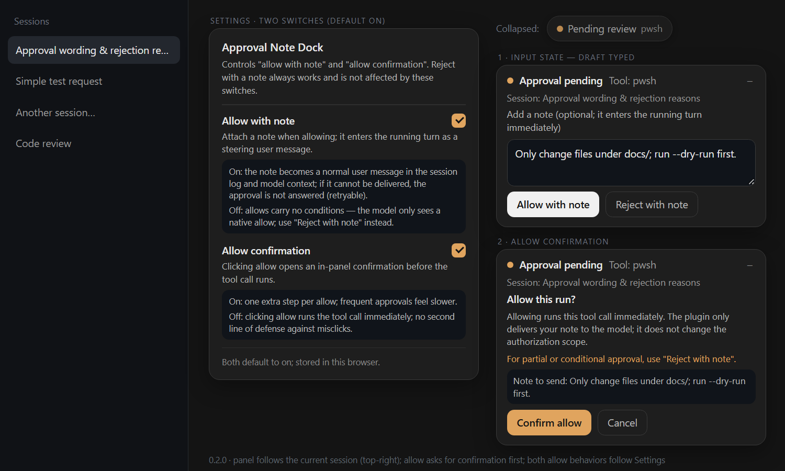

# dsh-approval-reason-dock

[](https://github.com/FzqxDedafeiyu/dsh-approval-reason-dock/actions/workflows/ci.yml)
[](https://www.npmjs.com/package/dsh-approval-reason-dock)
[](LICENSE)
[](https://dsh-plugin.org/plugins/fzqxdedafeiyu/dsh-approval-reason-dock)

An additive web-client plugin for [DeepSeek Harness](https://github.com/deepseek-ai) that attaches an optional **note** to either approval decision: a rejection reason, or an allow note. The note is delivered into the running turn as a steering user message *before* the approval is answered, so the model reads it in its next step instead of guessing why the action was denied — or what constraints came with the permit. Allows are guarded by a confirmation view: the plugin only ships your note, it never widens what the approval authorizes.

[中文说明](README.zh.md)

## Preview



## Why

Harness approval prompts offer `Allow once` / `Reject` only. The result is a closed outcome value with no note channel, so the model gets a bare "the user rejected tool X" — or a bare allow with none of the constraints you meant to attach. Both gaps matter in practice:

- A denial often carries context ("the network is unreliable", "do not touch that file yet") that belongs in the conversation immediately, not in a follow-up turn.
- An allow often carries constraints too ("only change files under docs/", "run `--dry-run` first", "send me the diff next turn"). Without a note the model learns them only after the action already ran.

Allowing is also the riskier direction: one click executes the tool call. So the panel asks for confirmation before every allow, explains that allowing runs the call immediately while the plugin itself only delivers the note and does not change the authorization scope, and points partial or conditional approval to **Reject with note** — DSH approval results are only allow/reject, so conditions have to travel as a rejection reason for the model to redo the step.

This plugin adds a small frame-wide panel on top of the host UI. It does **not** replace the built-in approval card, does **not** change the approval protocol or audit events, and fails soft: if the panel cannot render, the built-in card keeps working exactly as before.

## Behavior

- While the active session has an answerable approval, a panel appears in the top-right corner (`shell.overlay` slot).
- The panel follows the session shown in the main view: only that session's approval is offered, and approvals in other sessions stay quiet until you switch to them. The panel header shows the session title.
- The panel starts expanded and can be collapsed into a semi-transparent “Pending review” pill so it does not cover the conversation; clicking the pill expands it again. Each new approval starts expanded.
- Note drafts are kept per approval, so switching between several sessions with pending approvals does not wipe the text typed for the other one.
- The buttons follow the draft:
  - empty input: **Allow once** / **Reject** — the native outcomes, no message is sent;
  - non-empty input: **Allow with note** / **Reject with note**.
- **Allow is two steps, with or without a note**:
  1. clicking either allow button opens a confirmation view inside the panel — title, what allowing actually does (the tool call runs immediately; the plugin only delivers your note and does not change the authorization scope), a warning that partial or conditional approval should use **Reject with note**, the note preview, and **Confirm allow** / **Cancel**. `Cancel` and `Esc` return to the input view with the draft kept and the approval still unanswered; `Enter` does not confirm; repeated clicks submit only once.
  2. **Confirm allow** delivers `` (approval allow note) <text> `` (only when a note is present) into the running session as a steering user message (`remote.session.prompt` with `mode: "steer"`, falling back to `mode: "queue"` when the turn no longer accepts steering), and only then answers the approval as `allowed-once`.
- **Reject with note** skips the confirmation view (the note is the confirmation): `` (approval rejection reason) <text> `` is sent first (steer → queue fallback), then the approval is answered as `rejected`.
- **A note delivery failure blocks the decision.** If the note cannot be delivered, the approval is **not** answered: the panel stays open with a dismissible error, the draft is kept, and retrying re-sends the note. Nothing is allowed (or rejected) without its note.
- A successful allow or reject closes the panel immediately and clears that approval's draft.
- Both allow behaviors — carrying a note and the confirmation step — follow the plugin's two [Settings](#settings) switches; **Reject with note** is always available and is not affected by them.

## Settings

The plugin registers a **Settings → Approval Note Dock** section with two switches. Both are stored in the current browser (`localStorage`) and only change the **allow** path — **Reject with note always works and is not affected by these switches**.

### Allow with note

Default: **on**.

- On: allows can carry a note. With a typed draft the buttons read *Allow with note* / *Reject with note*, and the note is delivered into the running turn (steer → queue) before the approval is answered.
- Off: allows carry no note; even with a typed draft the allow button stays *Allow once* and the draft is not sent. The model only sees a native allow — use *Reject with note* when you need conditions.

Risks:

- On: the note becomes a normal user message in the session log and model context; if it cannot be delivered, the approval is not answered (retryable).
- Off: allows carry no conditions — the model only sees a native allow; use "Reject with note" instead.

### Allow confirmation

Default: **on**.

- On: clicking allow first opens the in-panel confirmation view (cancelable); the tool call runs only after *Confirm allow*.
- Off: clicking allow runs the tool call immediately; the confirmation step is skipped.

Risks:

- On: one extra step per allow; frequent approvals feel slower.
- Off: clicking allow runs the tool call immediately; no second line of defense against misclicks.

Both default to on; stored in this browser (clearing site data restores the defaults).

## Non-invasive by design

This is the plugin's core selling point: it **adds a layer; it does not change DSH's security architecture**.

- **Client-only bundle.** No host half, no HTTP routes, no `tools/*` hooks — nothing of this plugin runs inside the DSH host process.
- **The built-in approval card is never replaced or edited.** The approval protocol, audit events, sandbox policy and permission checks stay exactly as shipped. The plugin only reads pending-approval metadata, calls the same `answer()` the built-in card calls (`allowed-once` / `rejected`), and delivers the note through the normal session prompt path.
- **The plugin never widens authorization.** The allow confirmation spells this out: allowing runs the tool call exactly as the built-in card would; the note is a hint to the model, not an extra permission. The plugin cannot grant anything beyond the approval being answered.
- **Fail-soft.** If the panel cannot render or crashes, approvals keep working through the built-in card with native behavior.
- **Subagent sessions are left alone.** DSH disables approval prompts there and auto-rejects escalation; the plugin never claims those interactions and renders nothing.
- **Human-readable trail.** The note is an ordinary steering user message, so the transcript records what was rejected/approved and why — useful when a human reviews or debugs a session later.

## Install

Requires DSH `0.2.2-rc.1` or a later `0.2.x` release (see `engines.dsh`).

Version match:

| DSH | Plugin | Status |
| --- | --- | --- |
| `0.2.1-rc.2` | `0.1.0` | verified stable; `0.1.1` is not supported on this line |
| `0.2.2-rc.1` | `0.1.1`+ | verified (all 0.1.1 real-machine tests ran here) |
| `0.2.2-rc.1`+ | `0.2.0`+ | verified on the DSH 0.2.2 line (allow note + allow confirmation) |

On DSH `0.2.1-rc.2`, install the verified older line explicitly:

```sh
dsh plugin --profile web add dsh-approval-reason-dock@0.1.0
```

Why 0.1.1 does not claim 0.2.1: it needs the client-side `uiSession` service
declared in `exports.inject`, and that service was not verified to exist in the
0.2.1 client runner. The DSH plugin manager evaluates `engines.dsh` for
compatibility, so 0.1.1 may be flagged as incompatible on 0.2.1; pinning
`@0.1.0` avoids depending on that check.

`0.1.2` was a documentation/market-sync release with runtime behavior identical
to `0.1.1`. `0.2.0` adds the allow note and the allow confirmation on top of the
same non-invasive client path; `engines.dsh` and the client inject set are
unchanged.

Install with the DSH CLI (npm package):

```sh
dsh plugin --profile web add dsh-approval-reason-dock
```

Preferred: install the bundle from the DSH UI (Plugin Manager → install bundle) using the npm package name or the GitHub spec:

```
dsh-approval-reason-dock
github:FzqxDedafeiyu/dsh-approval-reason-dock
```

Or from GitHub source with the CLI:

```sh
dsh plugin --profile web add github:FzqxDedafeiyu/dsh-approval-reason-dock
```

Manual profile patch (if you manage the profile yourself): add the bundle to `dsh.profile.bundles` and let its patch insert the row:

```yaml
- insert:
    - id: approval-reason-dock
      name: dsh-approval-reason-dock
```

The bundle ships `cordis.patch.yml`, `index.js` (empty Host half), `client.js` (browser half), `locale/*.json` and `icon.svg`.

## Compatibility and risks

- The browser half uses DSH client internals: the `shell.overlay` slot, `uiSession` session-status interactions, and `remote.session.prompt`. These APIs are not a stable public contract; a Harness upgrade may require a plugin update.
- If an internal API is missing, the panel stays hidden and approvals still work through the built-in card (fail-soft).
- The confirmation view and the two-step allow flow are implemented in the plugin bundle itself; the built-in card's own buttons are unchanged.
- The plugin sends no network requests and reads no session content beyond the pending approval metadata.

## Privacy

Whatever note you type — a rejection reason or an allow note — becomes a normal user message in the session log and model context (capped at 500 characters, plain text, never rendered as HTML), delivered through the ordinary session prompt path. It is not a private channel to the plugin: the host and the model treat it exactly like something you would have typed into the conversation. Nothing is sent anywhere else, and the plugin stores nothing outside the page.

## Uninstall

Remove the `dsh-approval-reason-dock` entry from `dsh.profile.bundles` (or use Plugin Manager → uninstall), then restart DSH.

## Development

```
node test/harness.mjs
```

`node test/harness.mjs` runs 309 checks: it verifies the manifest/packaging shape, loads the real `client.js` factory, and drives the approval flows against a fake React/Cordis/slot environment — allow/reject with and without notes, note delivery before the answer, the steer→queue fallback, the allow confirmation view (cancel, `Esc`, `Enter`, repeated clicks), the delivery-failure blocking path, the settings store and settings section (defaults, persistence, toggles), the allow behavior matrix under both switches, already-settled approvals, and the i18n/panel rendering. Component interactions render through `react-test-renderer` (dev-only). `npm run pack:check` verifies the published file list.

Repository layout:

```
client.js           browser half (window.__ModuleLoader__ bundle)
index.js            host half (no-op apply)
cordis.patch.yml    Loader row
locale/{en,zh}.json display metadata
icon.svg            plugin icon
test/harness.mjs    sandbox tests
.github/workflows/  CI
```

## Maintenance

Release, install/rollback, upgrade smoke tests and troubleshooting are documented in the
[maintenance handbook](docs/MAINTENANCE.md) (Chinese, written for this deployment).

## License

MIT. See [LICENSE](LICENSE).
