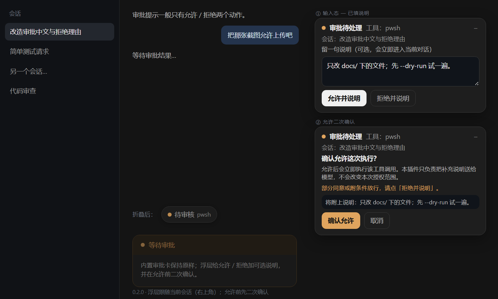

# dsh-approval-reason-dock

[](https://github.com/FzqxDedafeiyu/dsh-approval-reason-dock/actions/workflows/ci.yml)
[](https://www.npmjs.com/package/dsh-approval-reason-dock)
[](LICENSE)
[](https://dsh-plugin.org/plugins/fzqxdedafeiyu/dsh-approval-reason-dock)

给 [DeepSeek Harness](https://github.com/deepseek-ai) Web 端加一层**审批说明**：允许和拒绝都可以附一句话——拒绝时是理由，允许时是补充说明。插件会先把说明作为 steering 用户消息送进当前对话，再把审批答成对应结果，这样模型下一步就能读到，而不是只收到「用户拒绝了工具 X」或一个没有任何交代的放行。允许还会先弹一次二次确认：插件只负责把说明送给模型，**不会改变审批的授权范围**。

[English](README.md)

## 预览



## 为什么做这个

Harness 的审批卡只有「允许一次 / 拒绝」两个动作，结果是封闭的枚举值，协议里没有附带说明的通道。于是拒绝理由要么丢失、要么得等下一轮再说；允许时的交代（「只改 docs/ 下的文件」「先 `--dry-run` 试一遍」「下一轮把 diff 发我」）同样没地方放，模型往往要等动作执行完才补上一轮。

允许又是更危险的方向：点一下工具调用就会执行。所以插件在每次允许之前加了一次确认，讲清楚「允许会立即执行该工具调用、插件只负责送说明、不改变授权范围」，并提示**部分同意或附条件放行请点「拒绝并说明」**——DSH 的审批结果只有允许/拒绝，条件只能通过拒绝理由让模型按条件重做。

这个插件在宿主 UI 之上加一个小浮层，**不替换**内置审批卡、**不修改**审批协议与审计事件；渲染失败时静默隐藏，内置卡照常工作（fail-soft）。

## 行为

- 当前会话存在可作答的审批时，右上角出现浮层（注册在 `shell.overlay` 槽）。
- 浮层跟随主视图当前会话：只提供该会话的审批；其他会话的审批保持安静，切过去才会出现。标题下方显示会话名。
- 浮层默认展开，可折叠成半透明的「待审核」小按钮以免挡住正文，点击小按钮重新展开；每个新审批默认展开。
- 说明草稿按审批分别保留：多个会话同时挂审批时，来回切换不会清掉另一个会话已输入的文字。
- 按钮文案随输入框内容切换：
  - 空输入：**允许一次** / **拒绝** —— 原生行为，不发任何消息；
  - 非空输入：**允许并说明** / **拒绝并说明**。
- **允许是两步操作（带不带说明都一样）**：
  1. 点任意一个允许按钮，先在面板内打开二次确认视图：标题、允许后到底会发生什么（工具调用会立即执行；插件只负责把补充说明送给模型，不会改变本次授权范围）、「部分同意请点拒绝并说明」的提醒、说明预览，以及**确认允许** / **取消**。`取消` 与 `Esc` 回到输入态并保留草稿，审批仍未作答；`Enter` 不会触发放行；重复点击只提交一次。
  2. 点**确认允许**后才真正提交：有说明时先以 `` （审批同意说明）<文本> `` 作为 steering 用户消息送进当前轮（`remote.session.prompt` 的 `mode: "steer"`；当前轮不再接受 steering 时自动降级 `mode: "queue"` 排队），随后才把审批答成 `allowed-once`。
- **拒绝并说明**不经过二次确认（说明本身就是确认）：先以 `` （审批拒绝理由）<文本> `` 送进当前轮（steer → queue 降级），再把审批答成 `rejected`。
- **说明投递失败会阻塞本次决定。** 说明送不进去时审批**不会被作答**：浮层保留、显示可关闭的错误提示、草稿保留，可重试重发；不会出现「说明丢了但工具已经执行」。
- 允许或拒绝成功后浮层立即收起，并按审批清理草稿。

## 不侵入设计（本插件的核心定位）

这个插件只**加一层**，**不改变 DSH 的安全架构**：

- **纯客户端 bundle**：没有宿主半、没有 HTTP 路由、不挂 `tools/*` 钩子——插件没有任何代码运行在 DSH 宿主进程里。
- **从不替换或修改内置审批卡**：审批协议、审计事件、沙箱策略、权限校验全部保持官方原样。插件只读取待处理审批的元数据、调用内置卡同一个 `answer()`（`allowed-once` / `rejected`），并通过正常的会话 prompt 通道把说明送进对话。
- **插件不会扩大授权范围**：二次确认里会明确写出来——放行后工具调用按内置卡的同一个结果执行，说明只是给模型的提示，不是额外权限；插件无法授予审批之外的任何东西。
- **Fail-soft**：浮层无法渲染或崩溃时，审批仍按内置卡的原生行为正常工作。
- **子代理会话不接管**：DSH 在子代理上下文禁用审批并自动拒绝提权；插件不会声明这些交互，也不会渲染任何 UI。
- **人类可读的留痕**：说明是一条普通的 steering 用户消息，会话记录里能直接看到「拒绝了/同意了什么、为什么」，方便人工复盘与排查。

## 安装

要求 DSH `0.2.2-rc.1` 或同系列更高的 `0.2.x`（见 `engines.dsh`）。

版本匹配：

| DSH 版本 | 插件版本 | 状态 |
| --- | --- | --- |
| `0.2.1-rc.2` | `0.1.0` | 已验证稳定；`0.1.1` 不支持该版本线 |
| `0.2.2-rc.1` | `0.1.1`+ | 已验证（0.1.1 的全部真机测试都跑在这个版本） |
| `0.2.2-rc.1`+ | `0.2.0`+ | 已在 DSH 0.2.2 版本线验证（允许并说明 + 允许二次确认） |

在 DSH `0.2.1-rc.2` 上请显式安装已验证的旧版本线：

```sh
dsh plugin --profile web add dsh-approval-reason-dock@0.1.0
```

0.1.1 不声明支持 0.2.1 的原因：它需要客户端侧 `uiSession` 服务注入（`exports.inject`），而该服务在 0.2.1 的客户端 runner 中是否存在**未验证**。DSH 插件管理器会按 `engines.dsh` 做兼容性评估，0.1.1 在 0.2.1 上可能被标记为不兼容；固定安装 `@0.1.0` 可以不依赖那次校验。

`0.1.2` 是文档/市场素材同步版，运行时行为与 `0.1.1` 一致。`0.2.0` 在同一条非侵入客户端路径上新增「允许并说明」与「允许二次确认」；`engines.dsh` 与客户端 inject 集合保持不变。

用 DSH CLI 安装（npm 包）：

```sh
dsh plugin --profile web add dsh-approval-reason-dock
```

推荐：在 DSH 的插件管理页用 npm 包名或 GitHub spec 安装 bundle：

```
dsh-approval-reason-dock
github:FzqxDedafeiyu/dsh-approval-reason-dock
```

或者从 GitHub 源码用 CLI 安装：

```sh
dsh plugin --profile web add github:FzqxDedafeiyu/dsh-approval-reason-dock
```

手工管理 profile 的话：把 bundle 加入 `dsh.profile.bundles`，让它自带的 patch 插入行：

```yaml
- insert:
    - id: approval-reason-dock
      name: dsh-approval-reason-dock
```

包内包含 `cordis.patch.yml`、`index.js`（空宿主半）、`client.js`（浏览器半）、`locale/*.json`、`icon.svg`。

## 兼容性与风险

- 浏览器半依赖 DSH 客户端内部接口：`shell.overlay` 槽、`uiSession` 的会话状态交互、`remote.session.prompt`。这些不是稳定的公开契约，Harness 升级后可能需要更新插件。
- 内部接口缺失时浮层保持隐藏，审批仍可通过内置卡正常完成（fail-soft）。
- 二次确认视图与两步允许流程都实现在插件 bundle 内部，内置卡自己的按钮保持原样。
- 插件不发起网络请求，除待处理审批的元数据外不读取会话内容。

## 隐私

你输入的说明——无论是拒绝理由还是允许附言——都会成为会话日志与模型上下文里的普通用户消息（限 500 字、纯文本、不渲染 HTML），通过正常的会话 prompt 通道送达。它不是本插件的私密通道：宿主和模型会像对待你自己打进对话里的消息一样对待它。除此之外不会发往任何位置，插件也不在页面之外保存任何东西。

## 卸载

从 `dsh.profile.bundles` 移除 `dsh-approval-reason-dock`（或在插件管理页卸载），重启 DSH 即可。

## 开发

```
node test/harness.mjs
```

`node test/harness.mjs` 共 213 项检查：校验清单/打包形态、加载真实的 `client.js` factory，并在假的 React/Cordis/槽环境里驱动完整的审批流程——允许/拒绝（带与不带说明）、说明先于审批作答、steer→queue 降级、允许二次确认视图（取消、`Esc`、`Enter`、重复点击只提交一次）、投递失败的阻塞路径、审批已被别处处理，以及 i18n/浮层渲染。组件交互用 `react-test-renderer` 渲染（仅测试依赖）。`npm run pack:check` 校验实际发布文件清单。

仓库结构：

```
client.js           浏览器半（window.__ModuleLoader__ bundle）
index.js            宿主半（空 apply）
cordis.patch.yml    Loader 行
locale/{en,zh}.json 展示元数据
icon.svg            插件图标
test/harness.mjs    沙箱测试
.github/workflows/  CI
```

## 维护

发布流程、本机安装/回退、升级冒烟与排障见[交付与维护手册](docs/MAINTENANCE.md)。

## 许可证

MIT，见 [LICENSE](LICENSE)。
